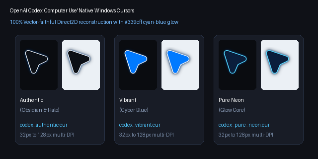

# Minimal Windows Cursor Theme 🖱️✨
> Clean, precision-crafted native Windows cursor pack with a signature cyan-blue neon halo (`#339cff`). Created by **ritam**.



---

## 🌟 Overview

**Minimal** is a high-precision, ergonomic cursor theme designed for Windows 10 and Windows 11. Built with mathematical cubic Bezier geometry and a luminous dual-layer Gaussian glow halo, it delivers a sleek aesthetic without draining your PC.

Unlike third-party mouse software or overlay applications (like MouseX or cursor hook apps) which run active GPU/CPU background rendering loops at 72+ FPS, **Minimal** consists of **genuine, native Windows `.cur` files**. It runs directly inside the Windows graphics kernel with **0% CPU and 0% GPU overhead**.

---

## ✨ Features

- **Multi-DPI Scaling Ready**: Each cursor embeds 5 individual pixel resolutions (**32×32, 48×48, 64×64, 96×96, and 128×128**) in standard 32-bit alpha DIB format. Looks razor-sharp on 100%, 125%, 150%, 175%, and 200%+ display scaling.
- **Calibrated Hotspots**: Click targets are aligned with pixel-perfect accuracy at the arrow tip.
- **Three Distinct Arrow Styles**:
  - **Authentic**: Dark obsidian body (`#0c1016`), crisp silver-white outline, and luminous cyan-blue glow (`#339cff`).
  - **Vibrant**: Electric cyber-blue filled body with silver outline and cyan glow.
  - **Pure Neon**: Deep cyan glow core for cyberpunk/dark setups.
- **Complete System Cursor Roles**: Includes matching cursors for Link/Hand, Text/I-Beam, Busy, Working in Background, Precision Crosshair, 4-Way Move, and Resizing.
- **Zero Resource Usage**: Pure Windows kernel execution. No background services, no overlays, no battery drain.

---

## 📦 What's Included

| File | Cursor Role | Description |
|---|---|---|
| `minimal_arrow_ritam.cur` | **Normal Select (Default)** | Obsidian body, silver outline, `#339cff` cyan glow |
| `minimal_vibrant_ritam.cur` | **Normal Select (Vibrant)** | Electric cyber-blue body with silver outline & cyan glow |
| `minimal_neon_ritam.cur` | **Normal Select (Neon)** | Deep cyan glow core |
| `minimal_link_ritam.cur` | **Link / Hand Select** | Arrow with glowing cyan touch indicator |
| `minimal_beam_ritam.cur` | **Text Select (I-Beam)** | Precision I-Beam with cyan neon illumination |
| `minimal_working_ritam.cur` | **Working in Background** | Arrow paired with glowing orbital accent |
| `minimal_busy_ritam.cur` | **Busy** | Orbital cyan ring |
| `minimal_cross_ritam.cur` | **Precision Select** | Crosshair |
| `minimal_move_ritam.cur` | **4-Way Move** | Pan / Move arrows |
| `minimal_help_ritam.cur` | **Help Select** | Arrow with query badge |
| `minimal_unavail_ritam.cur` | **Unavailable** | Forbidden indicator |
| `minimal_size_*_ritam.cur` | **Resizing** | Vertical, horizontal & diagonal resize cursors |
| `Install_by_ritam.inf` | **Setup File** | Standard Windows Right-Click $\rightarrow$ Install file |
| `Install_Live_by_ritam.ps1` | **Live Script** | 1-click live desktop activation (pwsh & WinPS) |
| `Uninstall_by_ritam.ps1` | **Restore Script** | Restores default Windows cursors |
| `guide.txt` | **Guide** | Step-by-step instructions |

---

## 🚀 Installation

### Option 1: 1-Click Live Installer (Recommended)
Right-click `Install_Live_by_ritam.ps1` and select **Run with PowerShell**. The theme applies immediately to your active desktop session without rebooting!

*To apply the vibrant blue arrow variant instead:*
```powershell
.\Install_Live_by_ritam.ps1 -Variant vibrant
```

### Option 2: Standard Windows Right-Click (.INF)
1. Right-click `Install_by_ritam.inf` and choose **Install** *(on Windows 11: Show more options $\rightarrow$ Install)*.
2. Press `Win + R`, type `main.cpl ,,1` and press Enter to open **Mouse Properties (Pointers)**.
3. Under **Scheme**, select **Minimal (by ritam)**.
4. Click **Apply** and **OK**.

### Option 3: Manual Selection
1. Open **Mouse Properties** (`main.cpl ,,1`).
2. Select **Normal Select**, click **Browse...**, select `minimal_arrow_ritam.cur`, and click **Apply**.

---

## 🔄 Uninstallation

To restore standard default Windows cursors:
- Right-click `Uninstall_by_ritam.ps1` and select **Run with PowerShell**, or
- Open Mouse Properties (`main.cpl ,,1`), choose `(None)` or `Windows Default`, and click **Apply**.

---

## 📜 License

Created and released by **ritam** under the [MIT License](LICENSE).
